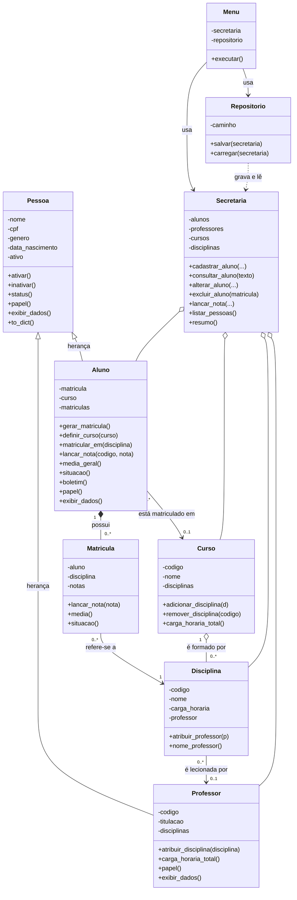

# Diagrama de classes — Sistema de Secretaria Acadêmica (IPOO)

## Leitura rápida

| Relação | Significado |
|---|---|
| `Pessoa <|-- Aluno` | **Herança**: Aluno é uma Pessoa e reaproveita nome, CPF, gênero, data e situação cadastral. |
| `Pessoa <|-- Professor` | **Herança**: Professor também é uma Pessoa; ambos sobrescrevem `papel()` e `exibir_dados()` (**polimorfismo**). |
| `Aluno *-- Matricula` | **Composição**: as matrículas só existem dentro do aluno; se o aluno é excluído, elas vão com ele. |
| `Curso o-- Disciplina` | **Agregação**: o curso é formado por disciplinas que existem independentemente dele. |
| `Secretaria o-- ...` | A Secretaria **guarda** as listas de objetos e concentra as regras de negócio. |
| `Menu --> Secretaria` | O Menu (tela) não guarda dados: só pede as operações para a Secretaria. |
